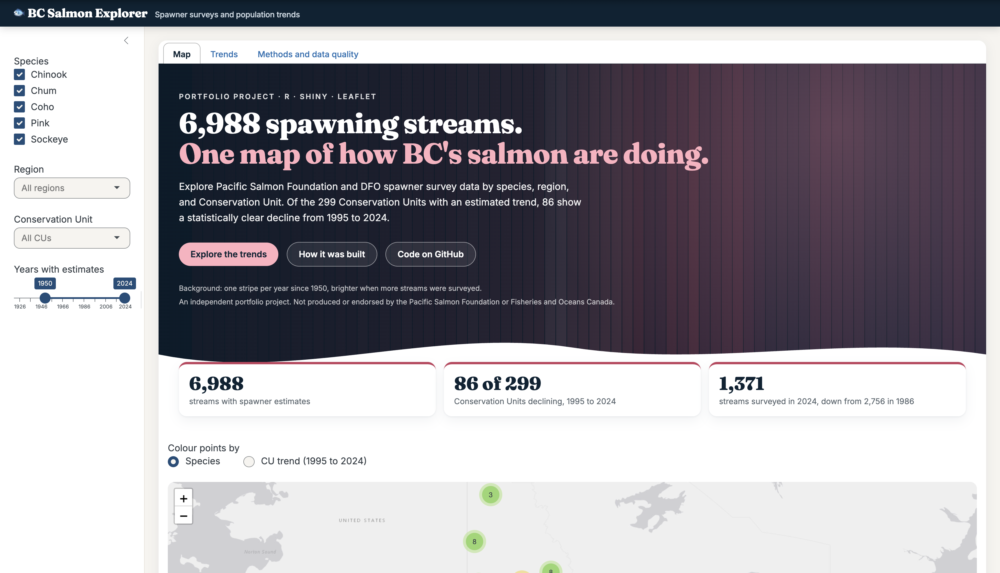

# BC Salmon Explorer

An interactive R Shiny app for exploring spawner abundance and recent trends for Pacific salmon in British Columbia and the Yukon, using the Pacific Salmon Foundation's cleaned NuSEDS spawner survey data.

**Live app:** https://emmabranch.shinyapps.io/bc-salmon-explorer/



## What it does

- **Map** of about 7,000 survey streams, coloured by species or by the estimated recent trend of their Conservation Unit (CU)
- **Filters** for species, region, Conservation Unit, and year range
- **Trends tab:**
  - an overview of estimated percent change per year, with 95% confidence intervals, for every CU matching the filters
  - for a selected CU, each stream's annual estimates with the CU-level trend line
  - a table of CU trend estimates, with low-data trends flagged as less reliable
- **Methods and data quality tab** explaining the data, cleaning steps, model, and limitations, with charts of survey coverage and survey quality over time

## Data

- Carturan, B. & Peacock, S. (2026). *Cleaned spawner survey data* (v4). Pacific Salmon Foundation. Zenodo. https://doi.org/10.5281/zenodo.19959144. Licensed under CC BY 4.0.
- Derived from Fisheries and Oceans Canada. *NuSEDS - New Salmon Escapement Database System*. Open Government Portal. https://open.canada.ca/data/en/dataset/c48669a3-045b-400d-b730-48aafe8c5ee6. Contains information licensed under the Open Government Licence - Canada.
- Cleaning methods: Pacific Salmon Foundation, [Pacific Salmon Explorer Technical Report, Appendix 2](https://salmonexplorer.ca/methods/appendix-2.html).

The raw file (about 300 MB) is not stored in this repository. See [`data-raw/README.md`](data-raw/README.md) for download instructions. The app uses two small processed files in `data/` (under 1 MB in total), shared under the same CC BY 4.0 terms with attribution as above.

This is an independent portfolio project. It is not produced or endorsed by the Pacific Salmon Foundation or Fisheries and Oceans Canada.

## Methods in brief

- **Abundance measure:** PSF's `MAX_ESTIMATE`, the largest available value among the NuSEDS spawner, removal, and total return fields for each stream and year.
- **Cleaning:** rows not matched to a current CU and stream-years with no estimate were removed; observed zeros were kept; each stream was checked to have one estimate per year and a single CU and location.
- **Trend model:** for each CU, 1995 to 2024, using streams with at least 5 years of estimates:
  - 3 or more streams: `lme4::lmer(log(spawners + 1) ~ year + (1 + year | stream))`, with year centred on 2010, falling back to a random-intercept model if singular
  - 1 or 2 streams: linear regression with a separate intercept per stream
  - The year slope is reported as an average percent change per year with a 95% confidence interval, and CUs are labelled Declining, Increasing, or No clear trend.
  - Trends based on fewer than 10 years of estimates are flagged as **Low data** (hollow points and dashed lines in the plots, and labelled in the trend table).

## Sensitivity check: autocorrelation

The main models assume independent errors, but salmon returns in neighbouring years are correlated. To test how much this matters, the 140 CUs with 3 or more streams were refitted in `glmmTMB` with and without AR(1) errors within each stream (`scripts/03_ar1_sensitivity.R`; both models converged for 127 CUs).

- **Autocorrelation is strong:** median correlation between consecutive years (phi) of 0.75.
- **It widens intervals, not trends:** compared with the same model without AR(1) errors, accounting for autocorrelation widened confidence intervals by a median of 58% but barely changed trend estimates (r = 0.97; median difference 0.4 percentage points per year). 24% of CUs moved to a different label, almost all to "No clear trend".
- **The app's models are largely robust:** the random-slope models used in the app already gave intervals about as wide as the AR(1) models (median ratio of standard errors 0.99), and 86% of CUs kept the same label. Changed labels were spread evenly across model types (about 1 in 7), suggesting CUs near a category boundary.
- **Caveat:** CUs with 1 or 2 streams (simple regression) could not be included. Their intervals are likely too narrow.

## Testing

`fit_trend()` has unit tests in `tests/testthat/`, written with `testthat`. They simulate CUs with known trends and check that the function recovers the true slope, gives sensible confidence intervals, picks the right model for 1, 2, and 3+ streams, falls back correctly when the random-slope model is singular, and counts streams, years, and observations correctly.

Run them from the project root with:

```r
testthat::test_dir("tests/testthat")
```

## Limitations

- Trend labels describe change in survey estimates. They are **not biological status assessments**.
- The app's models assume independent errors. The sensitivity check above found the mixed models largely robust to this, but intervals for CUs with 1 or 2 streams are likely too narrow.
- Survey coverage varies over time, and monitoring effort has declined in recent decades.
- Survey quality is unknown for most estimates, especially before 1995.
- `MAX_ESTIMATE` can reflect total returns as well as spawners.

Full details are in the app's Methods and data quality tab.

## Next steps

Code review suggested an AR(1) sensitivity check and unit tests for `fit_trend()`; both are now done (see above). Possible further work:

- Extend the autocorrelation check to CUs with 1 or 2 streams, for example with `nlme::gls()` and an AR(1) correlation structure.
- Show the AR(1) results in the app, for example as a toggle on the Trends tab.
- Run the tests automatically on every push with GitHub Actions.

## Repository structure

```
bc-salmon-explorer/
├── app.R                 # Shiny app (UI and server)
├── R/
│   ├── fit_trend.R       # Trend model for one CU (used by the app and scripts)
│   └── methods_tab.R     # Methods and data quality tab content
├── scripts/
│   ├── 00_explore.R      # First look at the raw data
│   ├── 01_clean.R        # Builds data/salmon_app.rds from the raw CSV
│   ├── 02_trends.R       # Fits CU trend models, builds data/cu_trends.rds
│   ├── 03_ar1_sensitivity.R  # AR(1) sensitivity check (glmmTMB)
│   └── deploy.R          # Deploys the app to shinyapps.io
├── data/
│   ├── salmon_app.rds    # Streams and annual estimates used by the app
│   ├── cu_trends.rds     # Pre-computed CU trend estimates
│   └── ar1_sensitivity.rds   # AR(1) sensitivity results
├── data-raw/
│   └── README.md         # How to download the raw data
├── tests/
│   └── testthat/         # Unit tests for fit_trend()
└── renv.lock             # Package versions (renv)
```

## Reproducing the analysis

1. Clone this repository and open `bc-salmon-explorer.Rproj` in RStudio.
2. Run `renv::restore()` to install the package versions used.
3. Download the raw data into `data-raw/` (see [`data-raw/README.md`](data-raw/README.md)).
4. Run `scripts/01_clean.R`, then `scripts/02_trends.R`, then (optionally) `scripts/03_ar1_sensitivity.R`.
5. Run the tests with `testthat::test_dir("tests/testthat")`.
6. Open `app.R` and click **Run App**.

Built with R 4.6, shiny, bslib, leaflet, dplyr, ggplot2, plotly, lme4, glmmTMB, and testthat. Deployed with rsconnect to shinyapps.io. Developed in RStudio with Git for version control and GitHub Copilot for code suggestions.

## Author

Emma Branch, PhD candidate in epidemiology, University of British Columbia.
