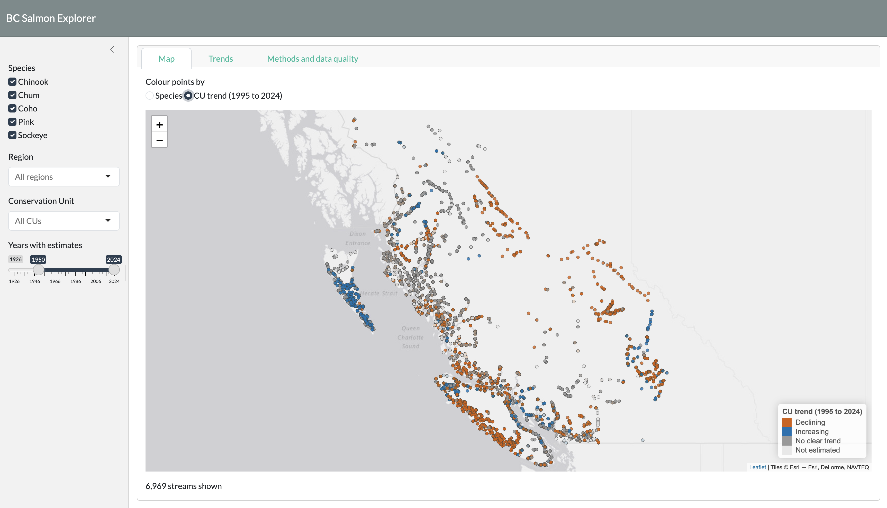

# BC Salmon Explorer

An interactive R Shiny app for exploring spawner abundance and recent trends for Pacific salmon in British Columbia and the Yukon, using the Pacific Salmon Foundation's cleaned NuSEDS spawner survey data.

**Live app:** https://emmabranch.shinyapps.io/bc-salmon-explorer/



## What it does

- **Map** of about 7,000 survey streams, coloured by species or by the estimated recent trend of their Conservation Unit (CU)
- **Filters** for species, region, Conservation Unit, and year range
- **Trends tab:**
  - an overview of estimated percent change per year, with 95% confidence intervals, for every CU matching the filters
  - for a selected CU, each stream's annual estimates with the CU-level trend line
- **Methods and data quality tab** explaining the data, cleaning steps, model, and limitations, with charts of survey coverage and survey quality over time

## Data

- Carturan, B. & Peacock, S. (2026). *Cleaned spawner survey data* (v4). Pacific Salmon Foundation. Zenodo. https://doi.org/10.5281/zenodo.19959144. Licensed under CC BY 4.0.
- Derived from Fisheries and Oceans Canada. *NuSEDS - New Salmon Escapement Database System*. Open Government Portal. https://open.canada.ca/data/en/dataset/c48669a3-045b-400d-b730-48aafe8c5ee6. Contains information licensed under the Open Government Licence - Canada.
- Cleaning methods: Pacific Salmon Foundation, [Pacific Salmon Explorer Technical Report, Appendix 2](https://salmonexplorer.ca/methods/appendix-2.html).

The raw file (about 300 MB) is not stored in this repository. See [`data-raw/README.md`](data-raw/README.md) for download instructions. The app uses two small processed files in `data/` (under 1 MB in total), shared under the same CC BY 4.0 terms with attribution as above.

This is an independent portfolio project. It is not produced or endorsed by the Pacific Salmon Foundation or Fisheries and Oceans Canada.

## Methods in brief

- **Abundance measure:** PSF's `MAX_ESTIMATE`, the largest available value among the NuSEDS spawner, removal, and total return fields for each stream and year.
- **Cleaning:** rows not matched to a current CU and stream-years with no estimate were removed; observed zeros were kept; each stream was checked to have one estimate per year and a single CU and location.
- **Trend model:** for each CU, 1995 to 2024, using streams with at least 5 years of estimates:
  - 3 or more streams: `lme4::lmer(log(spawners + 1) ~ year + (1 + year | stream))`, with year centred on 2010, falling back to a random-intercept model if singular
  - 1 or 2 streams: linear regression with a separate intercept per stream
  - The year slope is reported as an average percent change per year with a 95% confidence interval, and CUs are labelled Declining, Increasing, or No clear trend.

## Limitations

- Trend labels describe change in survey estimates. They are **not biological status assessments**.
- The models assume independent errors, so confidence intervals are probably too narrow. An autoregressive error structure (for example with `glmmTMB`) would be a natural extension.
- Survey coverage varies over time, and monitoring effort has declined in recent decades.
- Survey quality is unknown for most estimates, especially before 1995.
- `MAX_ESTIMATE` can reflect total returns as well as spawners.

Full details are in the app's Methods and data quality tab.

## Repository structure

```
bc-salmon-explorer/
├── app.R                 # Shiny app (UI and server)
├── R/
│   ├── fit_trend.R       # Trend model for one CU (used by the app and scripts)
│   └── methods_tab.R     # Methods and data quality tab content
├── scripts/
│   ├── 00_explore.R      # First look at the raw data
│   ├── 01_clean.R        # Builds data/salmon_app.rds from the raw CSV
│   └── 02_trends.R       # Fits CU trend models, builds data/cu_trends.rds
├── data/
│   ├── salmon_app.rds    # Streams and annual estimates used by the app
│   └── cu_trends.rds     # Pre-computed CU trend estimates
├── data-raw/
│   └── README.md         # How to download the raw data
└── renv.lock             # Package versions (renv)
```

## Reproducing the analysis

1. Clone this repository and open `bc-salmon-explorer.Rproj` in RStudio.
2. Run `renv::restore()` to install the package versions used.
3. Download the raw data into `data-raw/` (see [`data-raw/README.md`](data-raw/README.md)).
4. Run `scripts/01_clean.R`, then `scripts/02_trends.R`.
5. Open `app.R` and click **Run App**.

Built with R 4.6, shiny, bslib, leaflet, dplyr, ggplot2, plotly, and lme4. Deployed with rsconnect to shinyapps.io. Developed in RStudio with Git for version control and GitHub Copilot for code suggestions.

## Author

Emma Branch, PhD candidate in epidemiology, University of British Columbia.
